# Fund Foresight

Fund Foresight is a comprehensive budgeting app that helps users centralize and manage their financial life by tracking transactions, setting budgets, and providing insightful reports from all over the country. The app integrates with Plaid to fetch transaction data and allows users to manually add their own transactions.

## Features

- **Transaction Management**: Fetch transactions from multiple banks using Plaid and manually add your own.
- **Budgeting**: Create, edit, and delete budgets for different categories.
- **Saving Goals**: Set and track your saving goals to ensure you meet your financial objectives.
- **Notifications**: Get notified about budget limits, large transactions, and salary credits.
- **Manage Preferences**: Customize your app settings, including notification preferences, theme, and country.
- **User Authentication**: Supports both traditional login and Google authentication.
- **Responsive Design**: Works seamlessly on both web and mobile devices.
- **Real-time Updates**: Fetch transaction data on each reload while maintaining previous transaction visibility.

## Data flow

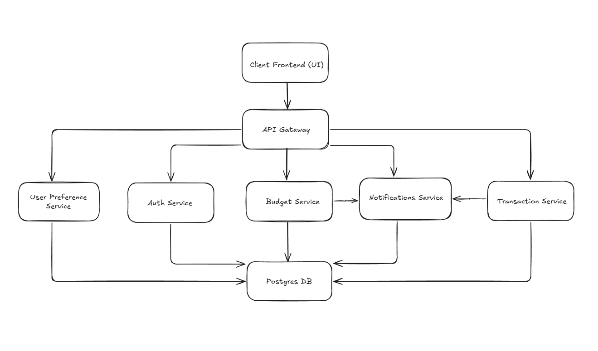

## Tech Stack

- **Frontend**:
  - React
  - React Native
  - Redux for state management
  - TypeScript
  - ShadCN for UI components

- **Backend**:
  - Spring Boot for transaction management with Plaid integration
  - Node (TypeScript and JavaScript)
  - Express
  - Go
  - PostgreSQL for data storage

- **Other**:
  - Docker for containerization
  - Kubernetes for orchestration and management of containerized applications
  - Plaid API for fetching financial data
  - JWT for user authentication
  - Kafka for messaging between services

## Demo

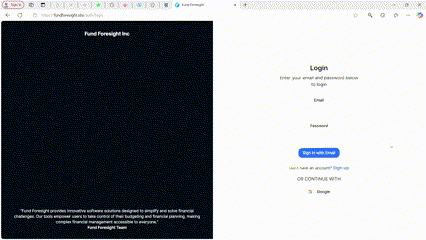

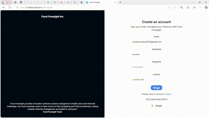

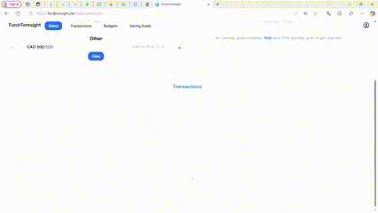

## Wireframes

  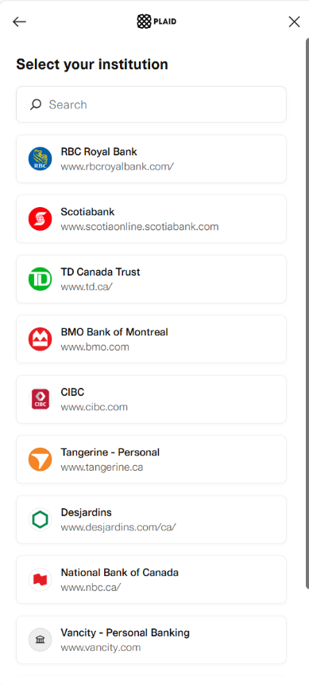
  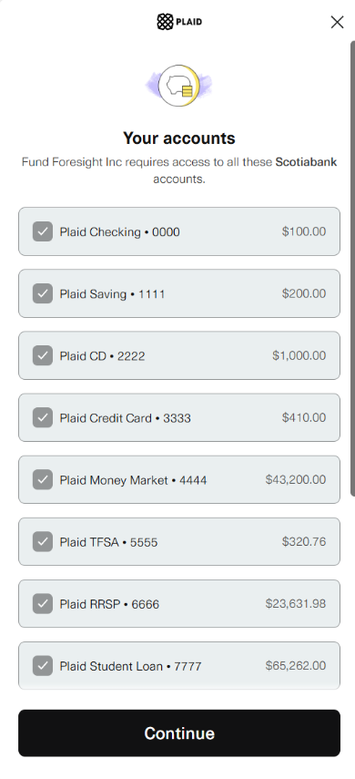
  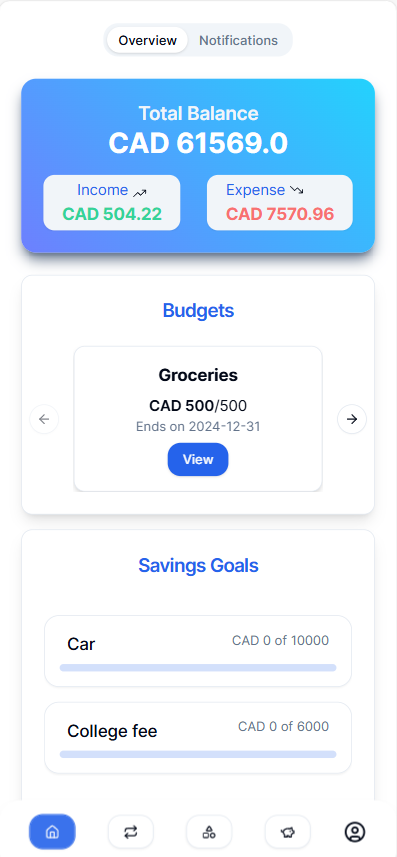
  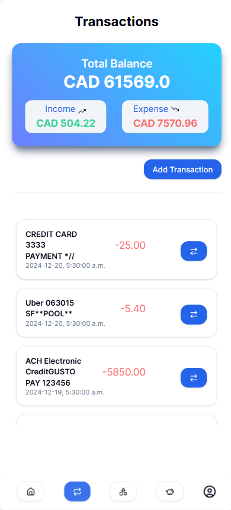
  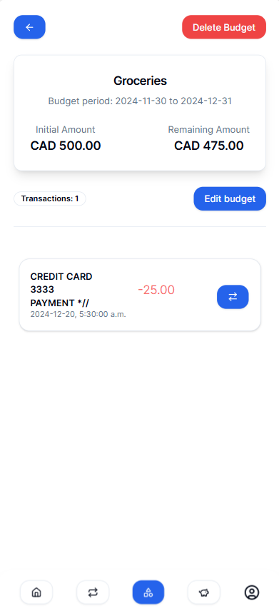
  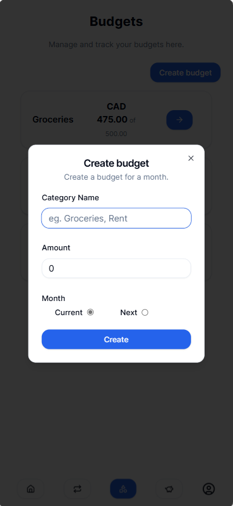
  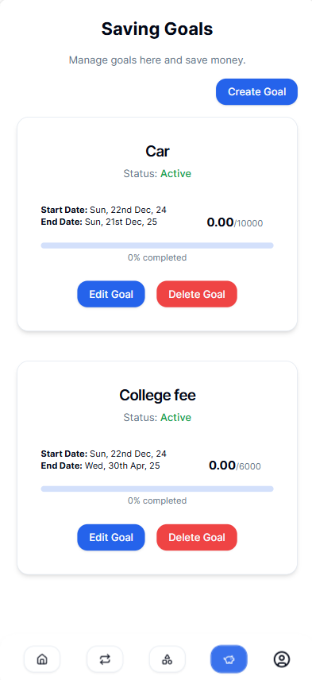
  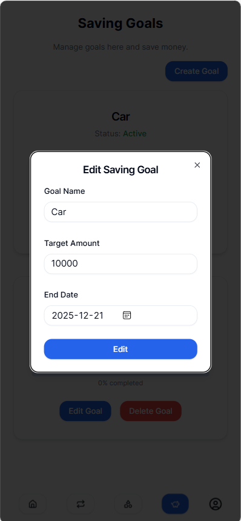

## Live

Check out the live website at [Fund Foresight](https://fundforesight.site) to see the app in action.